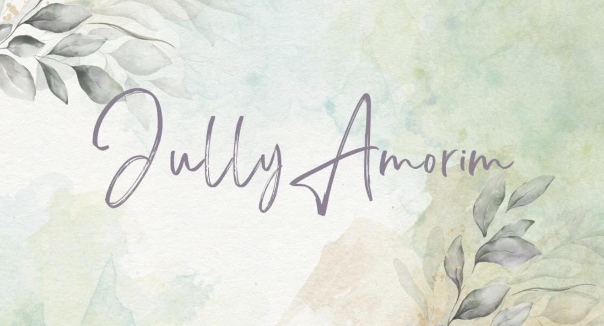
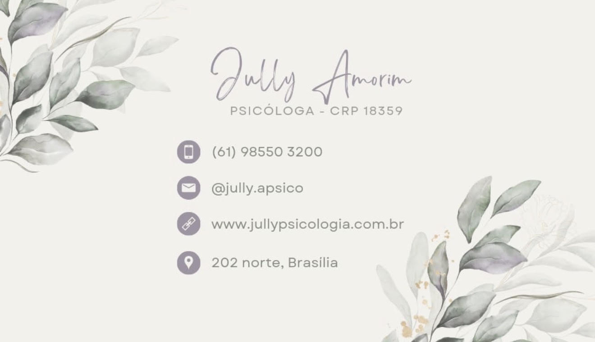

# Diagnóstico

Análise das peças que existem hoje — capa em aquarela, cartão de visita, site e Instagram — e do que muda com este brandbook.

## Capa em aquarela (assinatura)

- **Fundo:** lavagens de aquarela em verde-sálvia `#d2ddca`, verde-água `#e4ebe8` e areia/pêssego `#ebe3d6`, com textura de papel visível. Transmite calma, natureza e processo.
- **Folhagem:** ramos de eucalipto em aquarela, verde-acinzentado (`#6e716c` nas sombras, `#969992` nos meios-tons) com um véu lilás nas folhas — esse lilás é o elo com a cor do nome. Posicionados em diagonal (superior esquerdo / inferior direito).
- **Assinatura:** "Jully Amorim" em script de pincel seco, traço fino e irregular, cor lavanda-acinzentada `#88818b`. O "A" com laço é o detalhe mais memorável.
- **Respingos dourados** `#dccbb0` em poucos pontos — sofisticação discreta.
- **Leitura:** delicada, feminina, artesanal, acolhedora. Coerente com Gestalt (presença, processo) e com arteterapia.
- **Ponto de atenção:** em tamanho pequeno (avatar do Instagram, rodapé) o traço fino e o fundo aquarelado se misturam; por isso este sistema separa a assinatura em PNG transparente nas versões lavanda, ameixa e branco.

## Cartão de visita

- **Base:** papel off-white `#f2f1ec`, mesma folhagem em diagonal, assinatura no topo e linha "PSICÓLOGA - CRP 18359" em sans geométrica caixa alta espaçada.
- **Ícones:** círculos cheios em lavanda `#9c95a1` com glifo branco — bom recurso, vira padrão da marca.
- **Problemas encontrados:**
  1. **CRP incompleto:** o cartão traz "CRP 18359"; o site traz "CRP 01/18359". O número deve aparecer com a região: **CRP 01/18359**.
  2. **Ícone errado:** o @ do Instagram está ao lado de um **envelope** (ícone de e-mail).
  3. **Três perfis diferentes:** o cartão diz **@jully.apsico**, o site aponta **@jully.psicologia** e o link enviado é **@jullypsiquearte**.
  4. **Contraste baixo:** o texto cinza `#a4a49e` sobre `#f2f1ec` tem ~2,2:1 — difícil de ler impresso e abaixo do mínimo recomendado (4,5:1).
  5. **Domínio:** o cartão divulga www.jullypsicologia.com.br, mas o site ativo está em jullyucb.wixsite.com/psico. Não foi possível confirmar se o domínio redireciona (o endereço bloqueia acesso automatizado) — vale testar.

## Site (Wix)

- **Visual:** template Wix limpo — fundo branco, seções alternadas em verde-água acinzentado (aprox. `#d3dfdc`, estimado pela captura de tela), títulos em sans geométrica fina tipo Futura Light, menu em serifa itálica, botões retangulares sálvia, fotos de banco (consultório, mãos) e um retrato real da Jully.
- **Desconexão com a marca:** o site **não usa a assinatura, a lavanda, a folhagem nem a aquarela**. O cabeçalho é um retângulo com "JULLY AMORIM, PSICÓLOGA" em caixa alta. Quem vê o cartão e depois o site não reconhece a mesma marca.
- **O que aproveitar:** a fonte geométrica (por isso Jost no sistema), o verde-água (vira `agua`), o retrato e a estrutura de seções (Especialidade, Adolescentes, Adultos, Grupo, Arteterapia, Contato).
- **Conteúdo a revisar:**
  - Erros de digitação: "a abordagem que mais **se adequada**", "através **dos meu** tratamento", e-mail "jullyucb@**gmailcom**" (falta o ponto).
  - Rodapé "© 2021" e banner "Este site foi criado no Wix" (plano gratuito) passam sensação de site desatualizado.
  - Botão "Saiba mais" abre o WhatsApp — o rótulo deveria dizer o que acontece ("Agendar uma conversa").
  - **Depoimentos** (M.V., B.L., D.D.) e frases como "incrível transformação" e "da maneira mais eficiente e transformadora possível": orientações de publicidade ligadas ao Código de Ética do CFP tratam depoimentos de pacientes e promessas de resultado como práticas a evitar. Recomenda-se remover a seção e suavizar o texto — e confirmar com o CRP-01 em caso de dúvida.
  - A seção "Psicoterapia para Adultos" termina sem ponto final; "Adolescente: Encontre o seu caminho" mistura caixa alta no meio do título.

## Instagram

- O perfil **@jullypsiquearte** não pôde ser aberto nesta análise: o Instagram bloqueia leitura automatizada e a página retornou erro também no navegador. As recomendações abaixo valem para qualquer um dos três perfis.
- O nome **psiquearte** é um ótimo achado de posicionamento (psique + arte) — conversa diretamente com a arteterapia. Sugestão: **escolher um único @** (este ou @jully.psicologia) e atualizar cartão, site e assinatura de e-mail.
- **Grade sugerida:** alternar três tipos de post — reflexão (citação em Cormorant itálico sobre `areia`), educativo (título + carrossel sobre `papel`) e bastidores/arte (foto de materiais e processos criativos, sem pacientes). Capas de destaque em círculos `salvia`/`agua` com ícones de traço fino.
- **Bio:** "Jullyannie Amorim · Psicóloga CRP 01/18359 · Gestalt & Psicanálise · Arteterapia · Adolescentes e adultos · Asa Norte, Brasília".

## Síntese

| Hoje | Com o brandbook |
|---|---|
| Cartão e capa delicados; site genérico | Uma linguagem só: papel, aquarela, eucalipto e assinatura em todas as peças |
| 3 perfis de Instagram, CRP sem região | Identificação única e completa |
| Texto cinza-claro ilegível | Paleta com tons de texto acessíveis (≥ 4,5:1) |
| Sem regras de fonte | Cormorant Garamond + Jost, com escala definida |
| Arteterapia escondida | Arte como diferencial visual e de conteúdo |

**Fontes consultadas:** site jullyucb.wixsite.com/psico (acessado em 06/11/2026); orientações sobre publicidade de psicólogos — agilize.com.br (artigos sobre ética e Art. 20 do Código de Ética do CFP); site.cfp.org.br (orientações sobre publicidade nas redes sociais).
